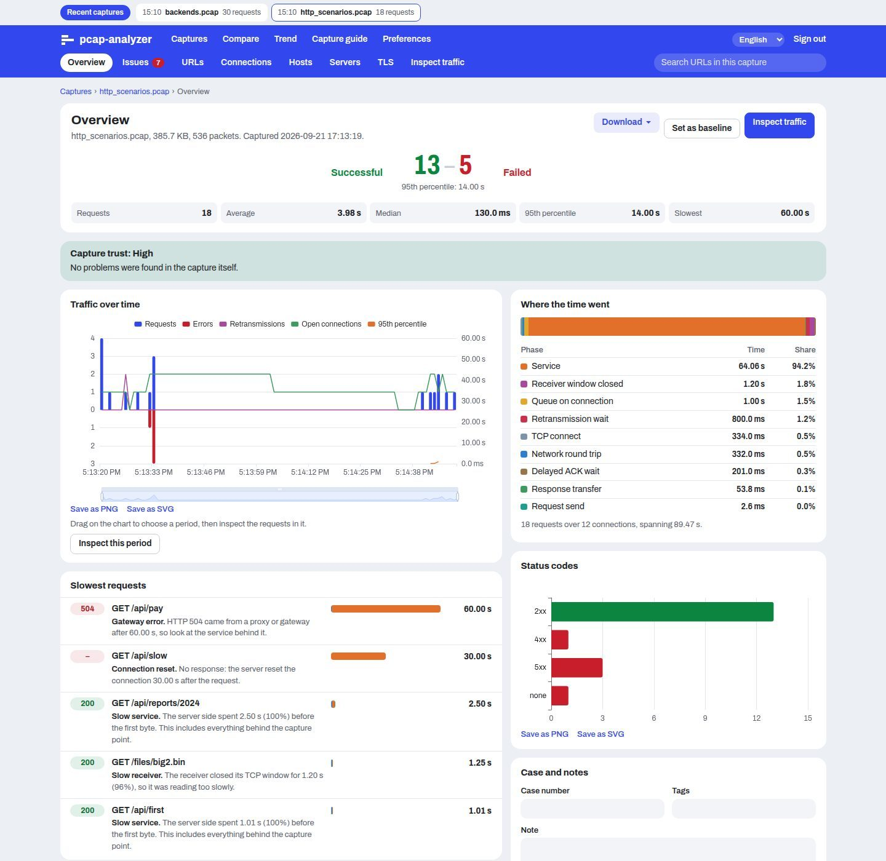
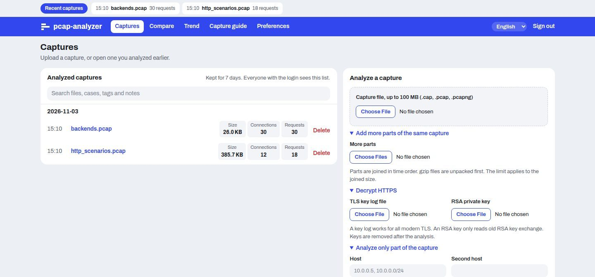
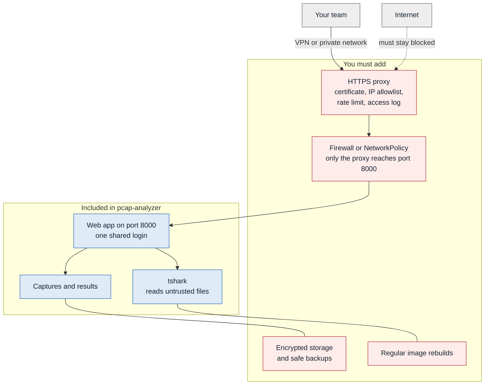

# pcap-analyzer

**Kubernetes edition.** Runs only on Kubernetes. Other editions: [pcap-analyzer-py-docker](https://github.com/maerdogan/pcap-analyzer-py-docker), [pcap-analyzer-py-linux](https://github.com/maerdogan/pcap-analyzer-py-linux), and [pcap-analyzer-py](https://github.com/maerdogan/pcap-analyzer-py) with every environment.

Find out why HTTP requests are slow, from a packet capture.

Upload a PCAP and see where the time went: connection setup, network delay, service time, data transfer, or packet loss. It runs on your own server, needs no internet access, and is designed for captures taken on either side of a load balancer such as NetScaler.





> [!WARNING]
> Do not expose this application to the internet. It is built for private networks, has had no independent security review, and leaves several protections to you. Read [Security](#security) before you deploy it.

## Features

- HTTP/1.1 and HTTP/2 timing per request, grouped by URL shape such as `/users/{id}`
- TCP connection list with the slowest requests of each connection
- Inspection of one traffic pair by source, destination, port, type, URL and size
- Root cause of slow requests in plain language, with next checks and sources from a bundled knowledge base. No AI model is used
- Trust summary for each capture, traffic over time, and a per-server view that shows the odd one out behind a load balancer
- Comparison of two captures, and what a load balancer adds, measured from its two sides
- Ready capture commands for Linux servers, pods and worker nodes, including VXLAN, Geneve and `tcpdump -i any`
- Turkish, English, German and Spanish
- HTTPS decryption with a TLS key log file or RSA key
- Wireshark's views in the browser: expert information as issues, protocol hierarchy, conversations, endpoints, packet lengths, IO graph, flow graph, Stevens, throughput, round trip and window graphs, Follow TCP Stream, Export Objects, Decode As, QUIC with HTTP/3, service response times of LDAP, Kerberos, SMB2, Kafka, SMTP, DCERPC, MQTT, AMQP and FTP, SIP calls and RTP jitter and loss
- Export to CSV, Excel, JSON, PNG, SVG, HTML, HAR and PCAP
- TLS view without a key: versions, ciphers, failed handshakes and certificate end dates
- WebSocket and gRPC handling, gzip captures and captures in several parts
- Captures up to 1 GB, read in parts of whole connections so memory stays near 700 MiB
- Limits per URL, a baseline capture, trends across captures, case notes and an activity log
- REST API with tokens ([docs/api.md](docs/api.md)), and `pcap-analyzer check` for CI

See the [usage guide](docs/usage.md).

> **Status: early release.** Tested with synthetic captures on tshark 4.4 and 4.6, with real Linux traffic in a network namespace lab (`tools/lab.py`), with captures from a Kubernetes node, a pod and an NGINX Ingress pod, and with production captures from a Linux server, a `tcpdump -i any` host and both sides of a load balancer, compared with tshark and the client's own timings. Read in parts, all of these captures give the same results as in one pass, and a generated 1 GB capture was analyzed in under 3 minutes. Compose, systemd and the Linux folder are installed and walked through from start to finish by `tools/check_install.sh`. VXLAN and Geneve are tested with kernel tunnels in the lab, not yet on a multi-node cluster.

## Quick start

Build the image and push it to a registry your cluster can reach, or use a [release](https://github.com/maerdogan/pcap-analyzer-py-k8s/releases) image.

```bash
docker build -f docker/Containerfile -t REGISTRY/pcap-analyzer:0.8.0 .
docker push REGISTRY/pcap-analyzer:0.8.0
```

Set the image and host name in `kubernetes/generic/`, then apply it:

```bash
kubectl create namespace pcap-analyzer
kubectl apply -k kubernetes/generic
```

Or with Helm:

```bash
helm install pcap-analyzer kubernetes/helm/pcap-analyzer -n pcap-analyzer --create-namespace --set image.repository=REGISTRY/pcap-analyzer,image.tag=0.8.0
```

The first sign-in is `admin` / `admin`, and the app asks for a new password before anything else. See [docs/install.md](docs/install.md) for the Secret, the Ingress, the NetworkPolicy and every setting.

| Folder | Holds |
|---|---|
| [kubernetes/base](kubernetes/base) | Deployment, Service and storage |
| [kubernetes/generic](kubernetes/generic) | Ingress and NetworkPolicy for any cluster with ingress-nginx |
| [kubernetes/helm](kubernetes/helm/pcap-analyzer) | Helm chart with Ingress, Gateway API and NetworkPolicy options |
| [kubernetes/vks](kubernetes/vks) | Example overlay for F5 NGINX Ingress Controller and Envoy Gateway |
| [docker/Containerfile](docker/Containerfile) | The image the manifests run |

## Development

```bash
pip install -e ".[dev]"
pytest
```

A tag such as `v0.8.0` runs the tests, then publishes the image and a GitHub Release from `RELEASE_NOTES.md`. `tools/release.py` refuses a tag that does not match the version or the image in `kubernetes/base/deployment.yaml`.

Tests use synthetic captures from `tools/gen_samples.py`. Their timings are known in advance, and they contain only private IP addresses and fake data.

## Security

Packet captures and TLS keys can contain passwords, session cookies and personal data, so anyone who reaches this application may reach that data. The red boxes below are not part of this project. You must add them yourself.



### What is not included

| Missing | Why it matters | What you must do |
|---|---|---|
| HTTPS by default | The container serves plain HTTP on port 8000, so the password, captures and TLS keys can be read on the network. | Put an HTTPS proxy in front, or start with `--cert` and `--key`. |
| Protection of port 8000 | Whoever reaches the pod directly skips your Ingress's HTTPS, IP allowlist and logs. | `kubernetes/generic` includes a `NetworkPolicy`. Set its controller namespace, and check that your network plugin enforces it. |
| Lockout that cannot be misused | Sign-in stops for 5 minutes after 5 failed logins from one address, or 30 from all addresses. Someone can use this to block logins for a while. Open sessions keep working. Behind a proxy, all users count as one address until you set `PCAP_ANALYZER_TRUSTED_PROXIES`. | Set that variable to your proxy's addresses, add a rate limit at the proxy, and limit who can reach the app. |
| Separate users and an audit log | Everyone shares one login that can read, download and delete every analysis. Nothing records who did it. | Limit who gets the password, change it when someone leaves, and keep access logs at the proxy. |
| Multi-factor login and SSO | One password protects all the data. | Use a long random password, and require a VPN or an authenticating proxy. |
| Encryption at rest | Captures, results and exports are plain files. Kubernetes Secrets are plain in etcd unless you turn on encryption. | Use encrypted disks and encrypted backups, and turn on etcd encryption. |
| Complete masking | Only known header and field names are masked. Raw captures and PCAP exports are never masked. | Treat every result, report and export as sensitive. Set `PCAP_ANALYZER_KEEP_CAPTURE=0` if you do not need PCAP export. |
| Secure wiping | Expired results are removed every hour while the server runs, and you can delete them yourself, but neither wipes the disk. | Rely on encrypted storage for safe disposal. |
| A sandbox for tshark | tshark parses untrusted files and shares the app's permissions and data. A flaw in tshark would expose everything the app can read. | Run it in a non-root container, update tshark often, and analyze only captures from sources you trust. |
| Pinned and signed releases | Python dependencies and the base image are not pinned. There are no signed images or vulnerability scans, and bundled JavaScript does not update itself. | Build your own image, scan it, and rebuild it regularly. |

### Before you upload

- Make sure you may capture and analyze this traffic. Captures can hold personal data, so your privacy rules apply, such as KVKK or GDPR.
- Treat a TLS key log like a password, because it decrypts every session it covers. Delete it after use. The app removes its copy after analysis. If a process is killed, the hourly cleanup removes the copy within 7 hours.
- gzip captures are unpacked up to the size limit. zstd and lz4 files are refused, because their real size cannot be checked. ZIP and other archives are refused with a note to extract them.
- Never commit captures or keys, and never attach them to public issues.
- `kubernetes/vks` is an example from one private lab. Do not reuse its addresses, and replace its self-signed certificate.

## License

[MIT](LICENSE). See [THIRD_PARTY.md](THIRD_PARTY.md) for bundled components.

## Roadmap

[ROADMAP.md](ROADMAP.md) lists every roadmap item and its state. The [project board](https://github.com/users/maerdogan/projects/6) is shared by all editions.
